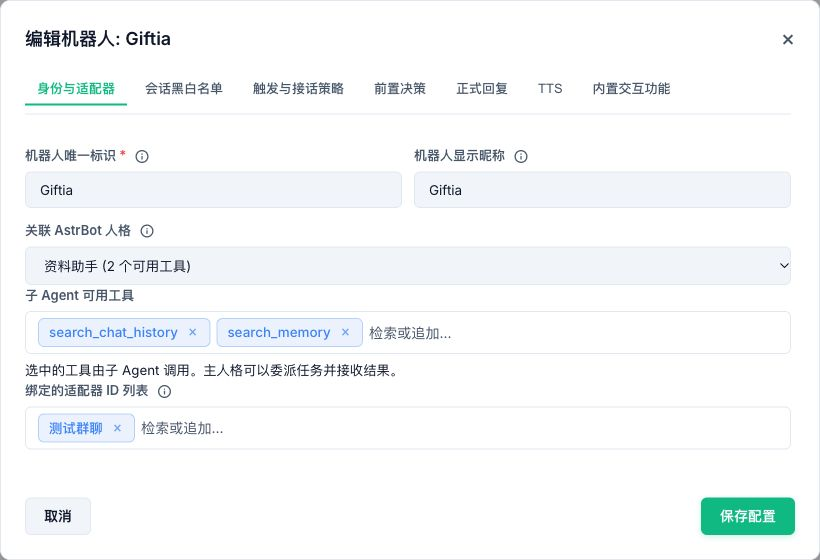

# Delegating tools to a subagent

Open **机器人配置 → 编辑机器人** in the dashboard. Choose an AstrBot persona under **身份与适配器**, then open **子 Agent**. Select the tools to give the subagent and save. The available choices follow the current persona and enabled function tools. Each selected tool moves to the subagent. Leaving the tool list empty disables delegation and omits its instructions from the formal reply system prompt.

The worker tries the **子 Agent 模型供应商** list from top to bottom. If you leave it empty, the worker inherits the providers and order from the formal reply that delegates the task.



The main persona can dispatch a task and acknowledge the user in one XML response. Put the following actions after the usual `<status>` block.

```xml
<sub_agent>Check supported versions and include release-note links.</sub_agent>
<message>I'll check the release notes.</message>
```

Each chat can have one active task through the end of report delivery. Combine related requests from the same reply in a single delegation tag. Other messages in the chat can be handled while the task runs. The active task appears in the formal reply context with its ID, original message, instructions, status, and remaining turns. To add a requirement, send `<sub_agent task_id="17">Also check Windows installation requirements.</sub_agent>` with the existing `task_id` and a new requirement.

The worker uses the parent reply's function-calling mode. Its tool-round budget uses the same `max_loop` setting. A new instruction restores the full budget. An in-flight tool finishes and its output is available on the next model turn. Duplicate submissions of the same instruction from the same input batch share a receipt. At the limit, the worker can summarize the evidence it has gathered.

The main persona claims a versioned report under the original chat's reply lock. A follow-up accepted before that claim supersedes the queued notification. After delivery, a later follow-up can continue the same transcript when the chat has no active task. Tool and model failures are reported to the parent. Restarting the plugin marks unfinished deliveries as interrupted and preserves their records.

In **聊天历史**, expand the task receipt to inspect its instructions, arguments, full tool outputs, errors and reports by revision. Workers wrap their natural-language report in `<report>...</report>`, which is validated and unwrapped before delivery to the main persona (malformed outputs follow retry and provider fallback rules); when message truncation is enabled (`reply_message_truncate_limit > 0`), delivered subagent reports allow at least 6,000 characters (`max(reply_message_truncate_limit, 6000)`, or unlimited when `<= 0`). Clearing a chat's history also removes its delegated transcripts. Worker model calls appear under **子 Agent** in Token statistics.

Main-agent native and XML function tool calls always log call metadata only: operation logs keep the tool name, time, and execution status without storing arguments or outputs, while the main agent still receives results within the current reply. Native tool loop calls within a single reply turn are deduplicated by tool name and folded into one operation log entry.
