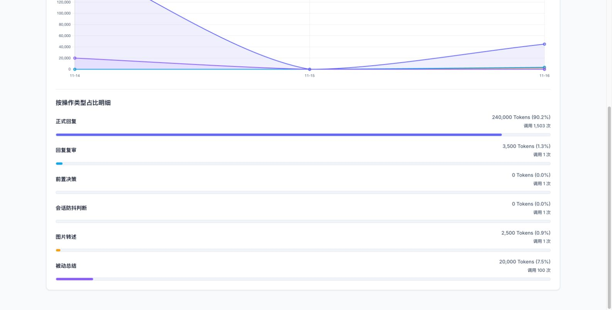

# Token statistics

Open **Token统计 (Token statistics)** in the WebUI and select a bot, session and time range. Switch between **按会话 (Session)**, **按模型 (Model)** and **按类型 (Operation type)** to view usage.

The breakdown below the chart shows each item's token usage, share of tokens and call count. Counts follow the same filters as usage and combine current logs with archived statistics. Items with calls and zero tokens still show their counts. TTS characters are tracked separately and excluded from these token call counts.

Counts reflect saved data; call counts missing from early archives cannot be reconstructed.

