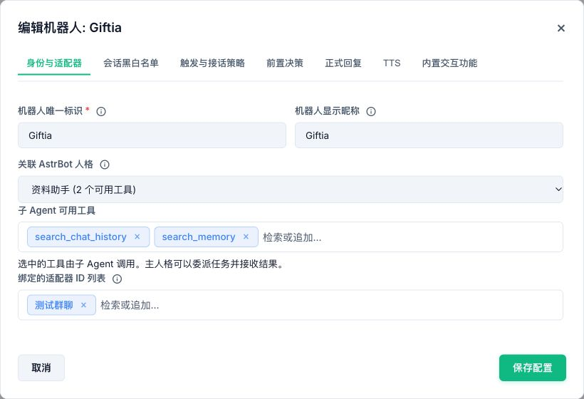

# 子 Agent 工具委派

打开 **机器人配置 → 编辑机器人 → 身份与适配器**。选择关联的 AstrBot 人格，在 **子 Agent 可用工具** 中选择要交给后台执行的工具，例如聊天记录检索或网页读取，然后保存。默认选项为空。候选项来自当前已启用且人格允许的函数工具，勾选后由子 Agent 独占。主人格仍可使用其余工具。



## 委派与追问

在正式回复的 `<status>` 后可以并列输出委派和进度消息。执行器按 XML 中的顺序派发。单独的委派回执会结束本轮回复，期间同一群聊或私聊可以继续处理其他消息。

```xml
<tool_call name="delegate_task">{"instruction":"核对插件支持的版本，附发布说明链接。"}</tool_call>
<message>我去查一下发布说明。</message>
```

活跃任务的编号、原消息、目标、状态和剩余轮次会出现在该会话的正式回复上下文中。补充要求时，使用当前任务编号。

```xml
<tool_call name="delegate_task">{"task_id":"17","instruction":"也查一下 Windows 的安装要求。"}</tool_call>
```

子 Agent 使用该次正式回复的模型提供商顺序和函数调用方式，轮次上限取自插件的 **工具调用轮数上限**。接受新的补充后，剩余轮次恢复到上限。已开始的工具可以完成，下一次模型请求会同时看到已有结果和新要求。同批同内容的重复派发只登记一次。额度耗尽后，子 Agent 根据已有证据收尾。

任务完成后，主人格通过原会话的回复锁领取报告，结合发起消息、追问和最近聊天组织回复。如果补充先被受理，旧报告留作参考，系统只投递最新版本。如果主人格已经领取上一份报告，新的追问可以沿用这个任务继续。执行失败也会产生报告。插件重启时，未交付的任务标记为中断，保留已有记录。

## 查看记录

在 **聊天历史** 中展开 **查看子任务的执行记录**，可以按任务版本查看委派要求、工具名和参数、完整输出、错误以及报告。主人格的上下文只接收状态和报告摘要，报告摘要沿用正式回复的单条消息长度配置。主人格直接调用的原生工具会在自己的操作记录中保存调用和结果。清空会话聊天历史时，同时清除该会话的子任务记录。子 Agent 的模型调用计入 **Token 统计**。
