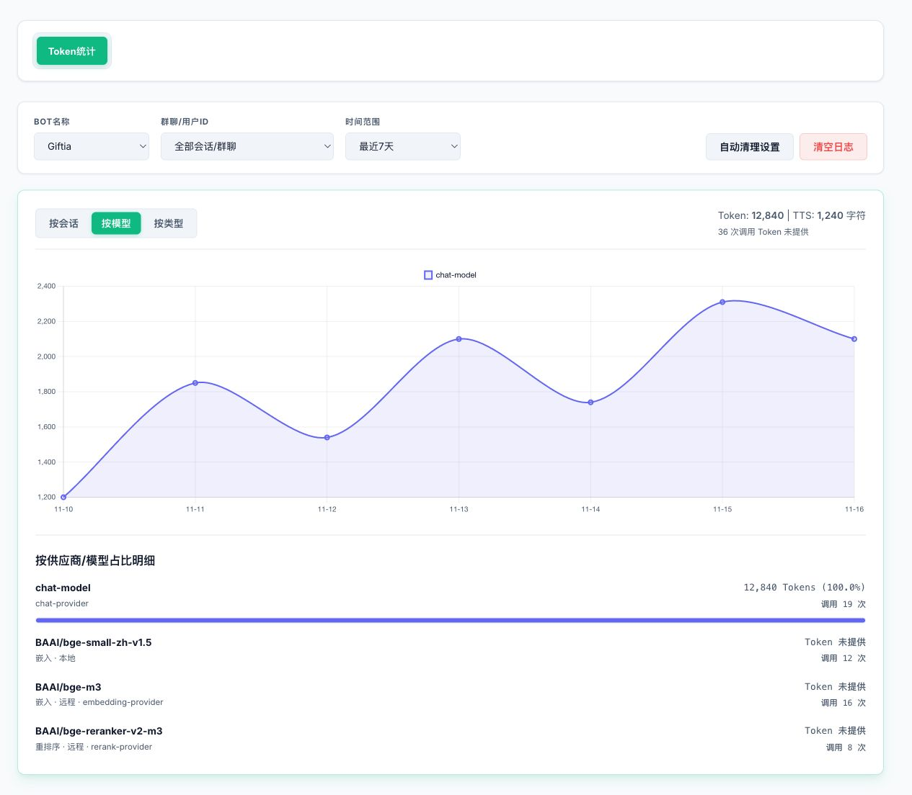

# Token 统计

打开 WebUI 的 **Token统计** 页签，选择 Bot、会话和时间范围后，可在 **按会话**、**按模型**、**按类型** 三个维度查看用量。

图表下方的占比明细逐项展示 Token 数量、Token 占比和调用次数。次数与用量使用相同的筛选范围，合并当前日志与历史归档；有调用但 Token 为 0 的项目仍显示次数。TTS 按字符单独统计，不计入这些 Token 调用次数。

**嵌入与重排序**也计入调用次数。在 **按模型** 中可查看完整模型名称、操作类型、本地或远程标识，以及远程模型的提供商 ID；在 **按类型** 中可查看嵌入、重排序各自的总次数和本地、远程次数。本地指 Giftia 内置 FastEmbed，远程指通过 AstrBot 模型提供商调用的服务。

调用次数按 Giftia 发起的模型调用计数，包含调用失败的尝试；一次重排多个候选仍算一次。未实际调用模型的空候选或提前跳过不计数。向量写入、查询和重排序的调用均按发起操作的 Bot 和会话记录，跨会话召回也归属于发起检索的会话。

当前 AstrBot 的嵌入、重排序接口不向 Giftia 返回 Token 用量，因此显示 **Token 未提供**，不显示零用量或 Token 占比，也不进入 Token 趋势。会话或汇总同时包含已知和未知用量时，显示已提供的 Token 总量，并单独提示多少次调用未提供 Token。次数和未提供状态会保留在历史归档中。

调用次数按已保存的数据汇总，未保存次数的早期归档无法补算。嵌入、重排序调用从启用本次更新后开始记录，历史调用无法补算。

